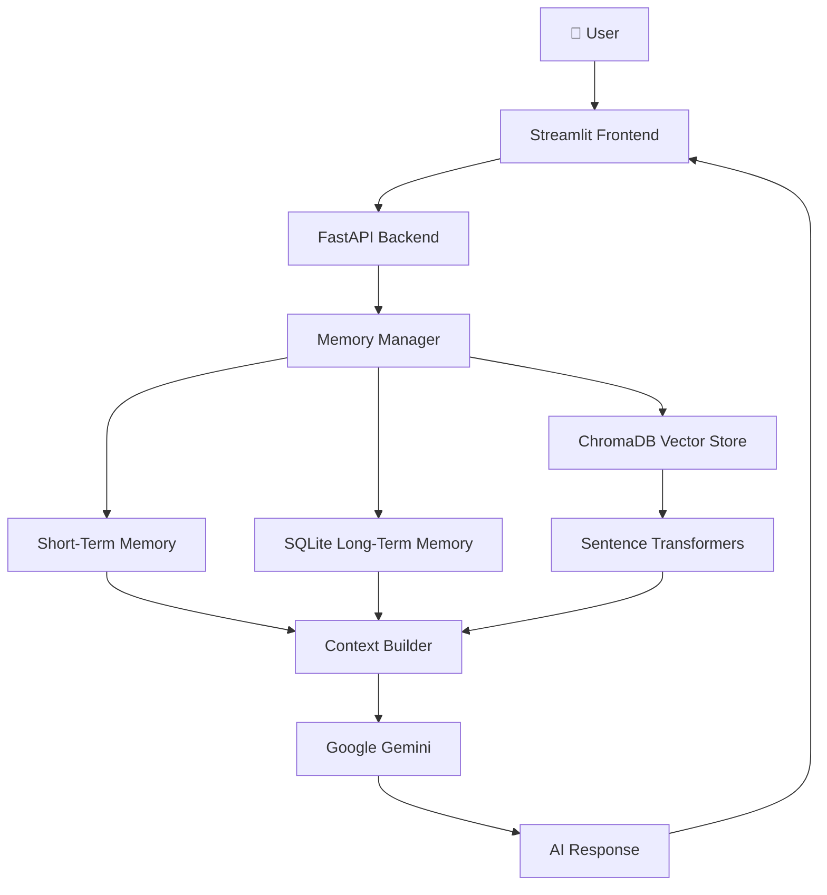

# 🧠 Memora — Advanced AI Agent Memory System

  <p align="center">
  **Give AI Agents a Memory That Lasts.**
  <br/>
  A context-aware AI assistant powered by semantic search, persistent memory, and intelligent retrieval.
  </p>

<p align="center">
  
  
  
  
</p>

<p align="center">
  
  
  
  
</p>

---

## 🚀 Overview

**Memora** is an intelligent AI memory system designed to overcome one of the biggest limitations of traditional AI assistants: the inability to retain meaningful context across conversations.

Powered by Google's Gemini models, Memora combines session-scoped short-term memory, persistent long-term memory, and vector-based semantic retrieval to create a more continuous and context-aware AI experience.

Instead of treating every conversation as an isolated interaction, Memora allows AI to retain useful information, retrieve relevant memories, and generate responses based on previously stored context.

## ✨ Key Features

| Feature | Description |
|---|---|
| 🧠 Short-Term Memory | Maintains context within an active session. |
| 💾 Long-Term Memory | Stores durable user facts using SQLite. |
| 🔍 Semantic Search | Retrieves relevant memories using vector similarity. |
| 🧬 Vector Embeddings | Generates local embeddings with Sentence Transformers. |
| 🤖 Gemini Integration | Uses Gemini for intelligent responses and fact extraction. |
| 🎛️ Memory Controls | Provides control over stored memories. |
| 💬 Conversational AI | Supports context-aware interactions through Streamlit. |
| ⚡ REST API | Exposes backend functionality through FastAPI. |

## 🏗️ System Architecture

Memora follows a modular architecture separating the user interface, API layer, memory storage, retrieval engine, and AI generation.



### 🔧 Technology Stack

| Component | Technology |
|---|---|
| AI Model | Google Gemini |
| Backend | FastAPI |
| Frontend | Streamlit |
| Primary Database | SQLite |
| Vector Database | ChromaDB |
| Embedding Model | Sentence Transformers |
| Package Management | uv |
| API Documentation | Swagger / OpenAPI |

## 📂 Project Structure

```text
Memora/
│
├── backend/
│   └── main.py
│
├── frontend/
│   └── app.py
│
├── .env.example
├── .gitignore
├── pyproject.toml
├── uv.lock
└── README.md
```

*Note: This represents the main application structure. Additional modules and database files may exist in your local project.*

## ⚙️ Installation & Setup

### Prerequisites

- Python 3.12+
- uv package manager
- Google Gemini API key
- Windows PowerShell

### 1. Configure Environment

Keep your existing `.env` file if you already have one.

Otherwise, create it from the example:

```powershell
Copy-Item .env.example .env
```

Add your Gemini API key to `.env` using the variable name defined in `.env.example`.

**Never commit your `.env` file or expose your API key.**

### 2. Install Dependencies

```powershell
uv sync
```

### 3. Start the Backend

Open Terminal 1:

```powershell
uv run uvicorn backend.main:app --reload
```

Backend:

`http://127.0.0.1:8000`

### 4. Start the Frontend

Open Terminal 2:

```powershell
uv run streamlit run frontend/app.py
```

Streamlit will provide a local URL, usually:

`http://localhost:8501`

### 5. Explore API Documentation

Access interactive Swagger documentation:

👉 http://127.0.0.1:8000/docs

## 🧩 How Memory Works

Memora uses multiple memory layers to provide context-aware AI interactions.

**1. Short-Term Memory**

Maintains conversation context within an active session, helping the assistant understand ongoing discussions.

**2. Long-Term Memory**

Stores durable user facts in SQLite for retrieval across conversations.

**3. Semantic Memory Retrieval**

Uses Sentence Transformers to generate embeddings and ChromaDB to identify semantically relevant stored information.

**4. AI Response Generation**

Retrieved context is incorporated into the prompt sent to Gemini, enabling more informed and personalized responses.

**5. Explicit Memory Requests**

Fact extraction and long-term memory storage are triggered through explicit remember requests rather than automatically saving every conversation.

## 🔐 Security & Limitations

Memora is currently an educational local application, not a production-ready multi-tenant platform.

Before deploying it for real users, consider implementing:

- Authentication and authorization
- User-level memory isolation
- API rate limiting
- Encryption at rest
- Database backups and recovery
- Audit logging
- Input validation and secure error handling
- Secure API key management

**Important:** Never store passwords, API keys, payment credentials, or highly sensitive personal information in the memory database.

## 🎯 Project Goals

Memora explores how persistent memory and semantic retrieval can improve the intelligence, continuity, and personalization of AI agents.

It provides a practical foundation for understanding:

- AI Agent Memory Architecture
- Semantic Search & Vector Retrieval
- Persistent Knowledge Storage
- Retrieval-Augmented Generation
- Context Engineering
- AI Application Development

## 🔮 Future Improvements

Potential directions for future development:

- Advanced memory consolidation
- Memory importance scoring
- Time-aware memory retrieval
- Multi-user memory isolation
- Hybrid search (semantic + keyword)
- Memory expiration and lifecycle management
- Agentic memory management
- Production deployment architecture

## 👨‍💻 Developer

**Saadi Mughal**

Generative AI Engineer | Agentic AI & Automation

Building intelligent AI systems, autonomous agents, and memory-driven applications.

- GitHub: [@saadimughal007](https://github.com/saadimughal007)
- Portfolio: [saad-portfolio-ai-engineer.netlify.app](https://saad-portfolio-ai-engineer.netlify.app/)

---

<p align="center">
  <strong>🧠 Memora — Beyond Stateless AI.</strong>
  <br/>
  <sub>Building AI systems that remember, retrieve, and reason with context.</sub>
</p>
